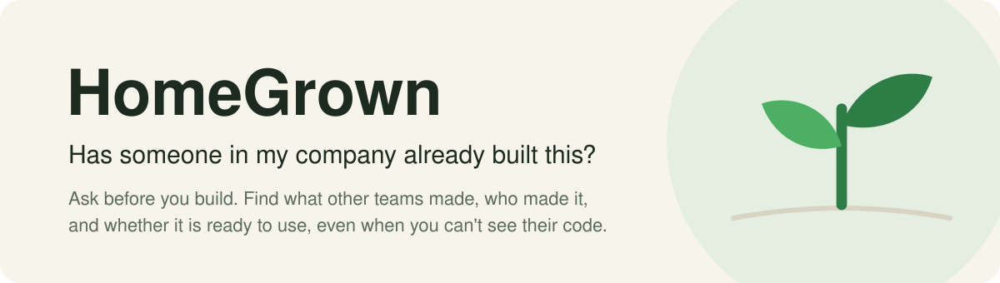
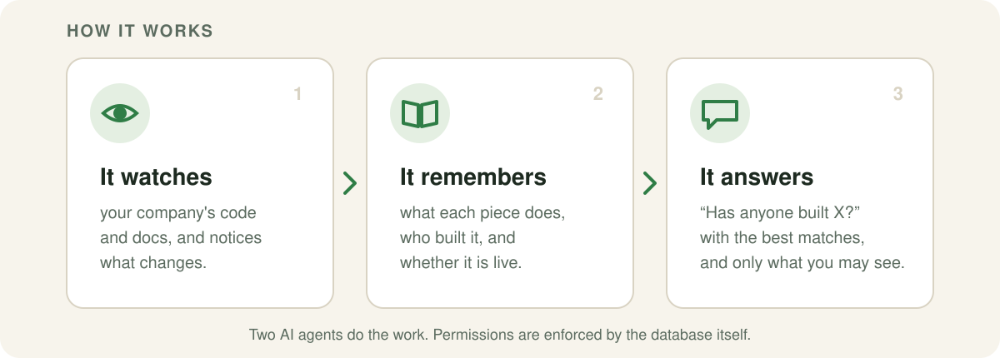
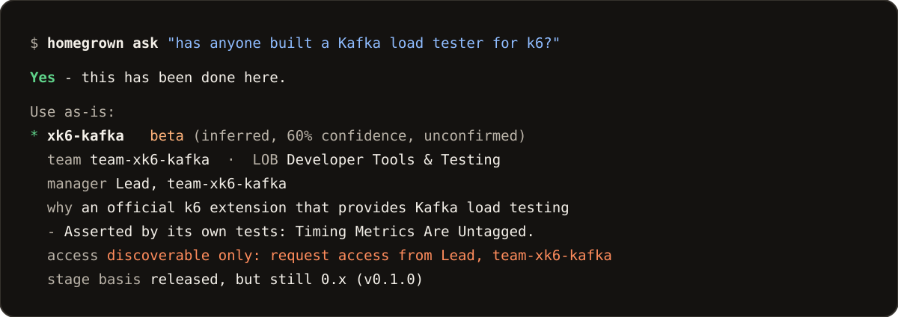

<picture>
  <source media="(prefers-color-scheme: dark)" srcset="docs/assets/hero-dark.svg">
  
</picture>

<p align="center">
  <a href="https://github.com/tancred27/home-grown/actions/workflows/ci.yml"></a>
  <a href="LICENSE"></a>
  
  
</p>

## Why

Big companies build the same thing over and over. One team writes a retry library, and
three teams later someone writes another. It's usually not laziness: most engineers can
only see their own team's code, and so can their AI coding assistant.

Ask HomeGrown in plain English, and it tells you:

- **what already exists** that does what you need,
- **who built it**, their team and their manager,
- **whether it's ready**: still in development or already in production,
- **how to get it**: read the code yourself, or who to ask for access.

It can do this even when you're not allowed to see the code. Knowing something exists
and who to ask is often enough.

## How it works

<picture>
  <source media="(prefers-color-scheme: dark)" srcset="docs/assets/how-it-works-dark.svg">
  
</picture>

Two AI agents share one database. The **collector** keeps track of everything your
company has built. The **answerer** finds the best matches for a question and checks
each one actually fits. It would rather say "I don't know" than send you to the wrong
place.

## What an answer looks like



<sub>From a real run on the public <a href="https://github.com/pallets">pallets</a> organization, trimmed for space. People's names are replaced with pseudonyms.</sub>

## Try it

You need Docker, Python 3.12+ and Git.

### 1. Install

```bash
git clone https://github.com/tancred27/home-grown.git && cd home-grown
cp .env.example .env
docker compose up -d                                  # PostgreSQL with pgvector
python -m venv .venv && source .venv/bin/activate     # Windows: .venv\Scripts\activate
pip install -e ".[dev]"
```

### 2. Point it at a GitHub organization

Give it a read-only GitHub token, then collect one organization. `pallets` is small and
public, so it makes a good first run.

```bash
echo "HOMEGROWN_GITHUB_TOKEN_FILE=/path/to/github-token.txt" >> .env
python -I scripts/sync_worker.py pallets --once
```

### 3. Ask

```bash
homegrown add-user alice && export HOMEGROWN_USER=alice
homegrown ask "has anyone built a way to escape HTML safely?"
```

Without a model, HomeGrown answers from the evidence alone and says "possibly" rather
than "yes". With one, it checks each match against your question. This is a real answer
from the Grafana test run, with a model on (people are pseudonyms):

```text
Yes - this has been done here.

Use as-is:

* xk6-kafka  [use_as_is]  stage: beta (inferred, 60% confidence, unconfirmed)
  team: team-xk6-kafka  |  LOB: Developer Tools & Testing  |  manager: Lead, team-xk6-kafka
  built by Engineer 4668f6 (team-xk6-kafka, reports to Lead, team-xk6-kafka, 77 commits, ...)
  why: xk6-kafka is an official k6 extension that provides Kafka load testing capabilities
  - Asserted by its own tests: Acks From Int.
  access: discoverable only: request access to github:xk6-kafka from Lead, team-xk6-kafka
  stage basis: released, but still 0.x (v0.1.0)
```

### 4. Add a model (optional)

Add one of these to `.env`, then set `HOMEGROWN_VERDICT_MODE=model`.

<details>
<summary><b>Anthropic</b></summary>

```bash
HOMEGROWN_LLM_PROVIDER=anthropic
ANTHROPIC_API_KEY=...            # or export it in your shell
```
</details>

<details>
<summary><b>Groq</b></summary>

```bash
HOMEGROWN_LLM_PROVIDER=groq
HOMEGROWN_GROQ_KEY_FILE=/path/to/groq-key.txt     # or GROQ_API_KEY
```
</details>

<details>
<summary><b>Gemini</b></summary>

```bash
HOMEGROWN_LLM_PROVIDER=gemini
HOMEGROWN_GEMINI_KEY_FILE=/path/to/gemini-key.txt # or GEMINI_API_KEY
```
</details>

<details>
<summary><b>A local model (Ollama or any OpenAI-compatible server)</b></summary>

```bash
HOMEGROWN_LLM_PROVIDER=local
HOMEGROWN_LLM_BASE_URL=http://localhost:11434/v1
HOMEGROWN_LLM_MODEL=your-model     # required for local: a model you have pulled
```
Nothing leaves your machines this way.
</details>

Free tiers may train on your prompts. Don't send private code to them.

### 5. Open the dashboard

```bash
uvicorn homegrown.api:app --port 8080
```

Then open <http://localhost:8080/ui> and enter a user, such as `alice`. The org map lists
every component that user may find, grouped by line of business, with its team, stage,
who else uses it and whether they can read the code. Each person sees only what the
database lets them see.

## Use it from your coding agent

HomeGrown is an [MCP](https://modelcontextprotocol.io) server, so Claude Code, Cursor and
other MCP clients can check it before they write new code:

```bash
claude mcp add homegrown -e HOMEGROWN_USER=alice -- /path/to/.venv/bin/python -m homegrown.mcp_server
```

A session then goes like this:

> **You:** Add Kafka produce and consume steps to our k6 tests.
>
> **Agent** calls `find_existing("produce and consume Kafka messages from k6 load tests")`
> and gets back *xk6-kafka · beta · team-xk6-kafka · use as-is*.
>
> **Agent:** xk6-kafka already does this. I'll build k6 with it instead of writing a new
> Kafka client.

The server also offers `ask`, `get_asset` and `report_reuse_outcome`.

## How well it works

Measured on real public code from Grafana, Microsoft, Google, AWS and others. Every
number comes from a script in [`scripts/`](scripts) with a write-up in
[`experiments/`](experiments).

| What we measured | Result | Where to check |
|---|---|---|
| Right component in the top 5, out of 109 | **94%** | [experiments/scale](experiments/scale/RESULTS.md) |
| The same, out of about 9,600 | **69–80%** | [experiments/scale](experiments/scale/RESULTS.md) |
| Says nothing fits, when nothing does | **26 of 26** (23 of 26 at ~9,600) | [judge results](experiments/scale/RESULTS_judge.md) |
| Search time across 300,000 vectors, with permission checks on | **~0.1 s** | [docs/results.md](docs/results.md) |
| From a push to processed, 95% of the time, replaying an hour of all public GitHub pushes | **225 s** | [experiments/sync](experiments/sync/RESULTS.md) |

**Not there yet**

- No company runs it in production yet.
- Accuracy drops as the company grows, mostly because of look-alike projects from other
  teams.
- No single sign-on, and code access isn't synced from GitHub yet.
- With a model on, each question costs two model calls, and nothing is cached between
  questions.

Every limit we know of is in [docs/results.md](docs/results.md).

## Roadmap

- [x] Collector and answerer agents, sharing one database
- [x] Permissions enforced by PostgreSQL row-level security
- [x] MCP server for coding agents
- [x] Traces and metrics with OpenTelemetry ([docs/observability.md](docs/observability.md))
- [x] Dashboard: the org map
- [ ] Dashboard: capabilities built more than once, and what people ask for that doesn't exist
- [ ] Better recall in large orgs with many look-alike components
- [ ] Caching across questions, scoped by permission
- [ ] Sign-in through an identity provider, and team and access sync from GitHub
- [ ] GitLab, Bitbucket and more documentation systems

More on where it's going: [VISION.md](VISION.md).

## Learn more

| Doc | What's in it |
|---|---|
| [How it works](docs/architecture.md) | The data model, permissions, both agents and the entry points |
| [Settings](docs/configuration.md) | Database, model, search, sync and telemetry settings |
| [Connecting GitHub](docs/github.md) | The token, the first index, staying current, webhooks, local mirrors |
| [Running it for a whole company](docs/production.md) | What you need, sizing from our measurements, what isn't built yet |
| [Traces and metrics](docs/observability.md) | Turning on OpenTelemetry, what is and isn't recorded |
| [Results and limits](docs/results.md) | Every measurement, and what still falls short |

## Contributing

Contributions are welcome. Start with [CONTRIBUTING.md](CONTRIBUTING.md). Please report
security problems privately, as described in [SECURITY.md](SECURITY.md).

## License

[Apache-2.0](LICENSE)
