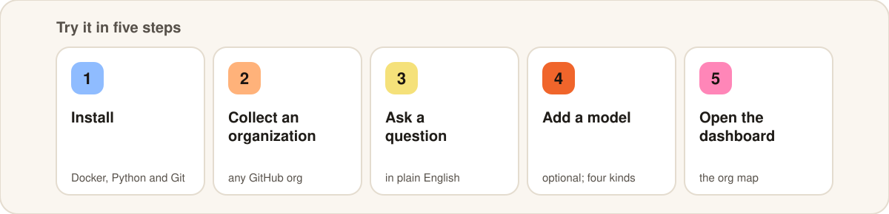
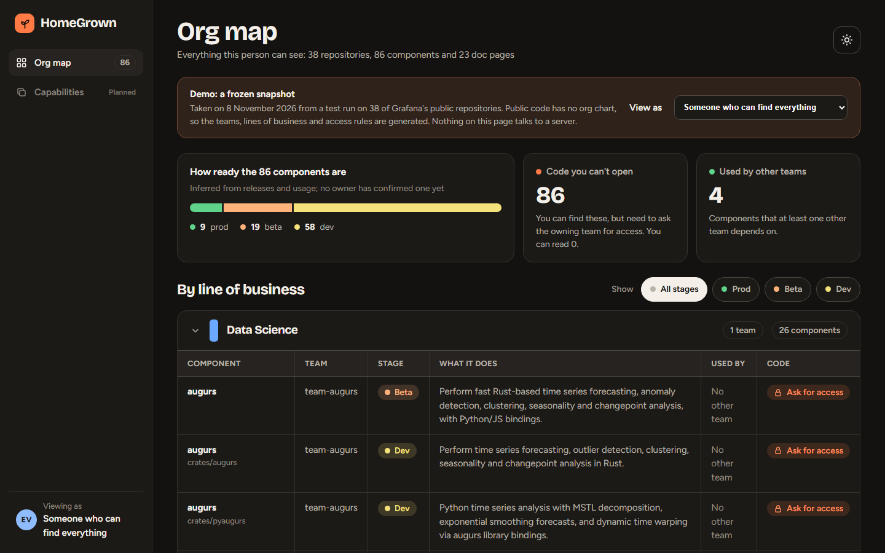
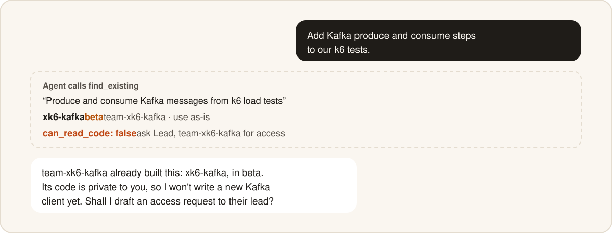
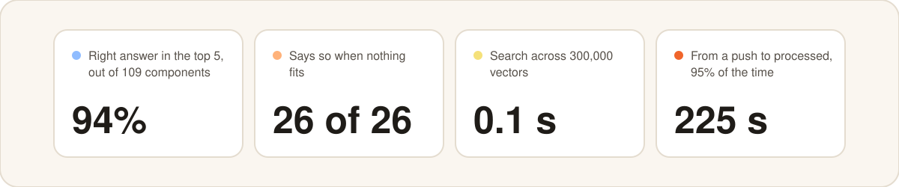

<picture>
  <source media="(prefers-color-scheme: dark)" srcset="docs/assets/hero-dark.svg">
  
</picture>

<p align="center">
  <a href="https://github.com/tancred27/home-grown/actions/workflows/ci.yml"></a>
  <a href="LICENSE"></a>
  
  
</p>

<p align="center">
  <a href="https://tancred27.github.io/home-grown/?theme=dark"><b>Website</b></a> ·
  <a href="https://tancred27.github.io/home-grown/demo/?theme=dark"><b>Demo dashboard</b></a> ·
  <a href="#try-it"><b>Try it</b></a> ·
  <a href="docs/architecture.md"><b>How it works</b></a> ·
  <a href="docs/results.md"><b>Results</b></a>
</p>

## Why

Big companies build the same thing over and over. One team writes a retry library, and
three teams later someone writes another. It's usually not laziness: most engineers can
only see their own team's code, and so can their coding agent.

Ask HomeGrown in plain English, and it tells you:

- **what already exists** that does what you need,
- **who built it**, their team and their manager,
- **how ready it is**: dev, beta or prod,
- **how to get it**: read the code yourself, or who to ask for access.

It can do this even when you're not allowed to see the code. Knowing something exists
and who to ask is often enough.

## How it works

<picture>
  <source media="(prefers-color-scheme: dark)" srcset="docs/assets/how-it-works-dark.svg">
  
</picture>

Two agents share one database. The **collector** keeps notes on everything your company
has built. The **answerer** finds the best matches for a question and checks that each
one fits. It would rather say "I don't know" than send you to the wrong place.

## What an answer looks like


<sub>A real answer from a test run on Grafana's public repositories, trimmed for space. Public code has no org chart, so the teams, leads and access rules in that test are generated, and people are pseudonyms.</sub>

## Try it

<picture>
  <source media="(prefers-color-scheme: dark)" srcset="docs/assets/try-it-dark.svg">
  
</picture>

You need Docker, Python 3.12+ and Git.

### 1. Install

```bash
git clone https://github.com/tancred27/home-grown.git && cd home-grown
cp .env.example .env
docker compose up -d                                  # PostgreSQL with pgvector
python -m venv .venv && source .venv/bin/activate     # Windows: .venv\Scripts\activate
pip install -e ".[dev]"
```

### 2. Point it at a GitHub organization

Give it a read-only GitHub token, then collect one organization. `pallets` is small and
public, so it makes a good first run.

```bash
echo "HOMEGROWN_GITHUB_TOKEN_FILE=/path/to/github-token.txt" >> .env
python -I scripts/sync_worker.py pallets --once
```

### 3. Ask

```bash
homegrown add-user alice && export HOMEGROWN_USER=alice
homegrown ask "has anyone built signed tokens that expire, for password reset links?"
```

Without a model, HomeGrown answers from the evidence alone and says "possibly" rather
than "yes". With one, it checks each match against your question, as in the example
above.

### 4. Add a model (optional)

Add one of these to `.env`, then set `HOMEGROWN_VERDICT_MODE=model`.

<details>
<summary><b>Anthropic</b></summary>

```bash
HOMEGROWN_LLM_PROVIDER=anthropic
ANTHROPIC_API_KEY=...            # or export it in your shell
```
</details>

<details>
<summary><b>Groq</b></summary>

```bash
HOMEGROWN_LLM_PROVIDER=groq
HOMEGROWN_GROQ_KEY_FILE=/path/to/groq-key.txt     # or GROQ_API_KEY
```
</details>

<details>
<summary><b>Gemini</b></summary>

```bash
HOMEGROWN_LLM_PROVIDER=gemini
HOMEGROWN_GEMINI_KEY_FILE=/path/to/gemini-key.txt # or GEMINI_API_KEY
```
</details>

<details>
<summary><b>A local model (Ollama or any OpenAI-compatible server)</b></summary>

```bash
HOMEGROWN_LLM_PROVIDER=local
HOMEGROWN_LLM_BASE_URL=http://localhost:11434/v1
HOMEGROWN_LLM_MODEL=your-model     # required for local: a model you have pulled
```
Nothing leaves your machines this way.
</details>

Free tiers may train on your prompts. Don't send private code to them.

### 5. Open the dashboard

Want to look first? The [demo dashboard](https://tancred27.github.io/home-grown/demo/?theme=dark)
is a frozen snapshot of the Grafana test run. It runs in your browser with no server,
and lets you switch between two people with different access.

<a href="https://tancred27.github.io/home-grown/demo/?theme=dark"></a>

To run it on your own data:

```bash
uvicorn homegrown.api:app --port 8080
```

Then open <http://localhost:8080/ui> and enter a user, such as `alice`. The org map lists
every component that user may find, grouped by line of business, with its team, stage,
who else uses it and whether they can read the code. Each person sees only what the
database lets them see.

There's no real sign-in yet: you type a user name, which is fine on your own machine
and not for a shared server. To refresh the demo from your own data, run
`python -I scripts/export_demo.py`.

## Use it from your coding agent

HomeGrown is an [MCP](https://modelcontextprotocol.io) server, so Claude Code, Cursor and
other MCP clients can check it before they write new code:

```bash
claude mcp add homegrown -e HOMEGROWN_USER=alice -- /path/to/.venv/bin/python -m homegrown.mcp_server
```

Each match says whether the person asking can read its code. When they can't, the agent
doesn't build against it or quietly write a copy. It says who owns it and offers to ask
for access:

<picture>
  <source media="(prefers-color-scheme: dark)" srcset="docs/assets/agent-dark.svg">
  
</picture>

If the code is readable, the agent uses it instead of writing a new Kafka client.

The server also offers `ask`, `get_asset` and `report_reuse_outcome`.

## How well it works

Measured on real public code from Grafana, Microsoft, Google, AWS and others. Every
number comes from a script in [`scripts/`](scripts) with a write-up in
[`experiments/`](experiments).

<picture>
  <source media="(prefers-color-scheme: dark)" srcset="docs/assets/results-dark.svg">
  
</picture>

| What we measured | Result | Where to check |
|---|---|---|
| Right component in the top 5, out of 109 | **94%** | [experiments/scale](experiments/scale/RESULTS.md) |
| The same, out of about 9,600 | **69–80%** | [experiments/scale](experiments/scale/RESULTS.md) |
| Says nothing fits, when nothing does | **26 of 26** (23 of 26 at ~9,600) | [judge results](experiments/scale/RESULTS_judge.md) |
| Search time across 300,000 vectors, with permission checks on | **~0.1 s** | [docs/results.md](docs/results.md) |
| From a push to processed, 95% of the time, replaying an hour of all public GitHub pushes | **225 s** | [experiments/sync](experiments/sync/RESULTS.md) |

**Not there yet**

- No company runs it in production yet.
- Accuracy drops as the company grows, mostly because of look-alike projects from other
  teams.
- No single sign-on, and code access isn't synced from GitHub yet.
- With a model on, each question costs two model calls, and nothing is cached between
  questions.

Every limit we know of is in [docs/results.md](docs/results.md).

## Roadmap

- [x] Collector and answerer agents, sharing one database
- [x] Permissions enforced by PostgreSQL row-level security
- [x] MCP server for coding agents
- [x] Traces and metrics with OpenTelemetry ([docs/observability.md](docs/observability.md))
- [x] Dashboard: the org map, plus a [static demo](https://tancred27.github.io/home-grown/demo/?theme=dark)
- [ ] Live demo: ask real questions against the demo repositories
- [ ] Dashboard sign-in that fits each company's own SSO or sign-in setup
- [ ] Dashboard: capabilities built more than once, and what people ask for that doesn't exist
- [ ] Better recall in large orgs with many look-alike components
- [ ] Caching across questions, scoped by permission
- [ ] Sign-in through an identity provider, and team and access sync from GitHub
- [ ] GitLab, Bitbucket and more documentation systems

More on where it's going: [VISION.md](VISION.md).

## Learn more

| Doc | What's in it |
|---|---|
| [How it works](docs/architecture.md) | The data model, permissions, both agents and the entry points |
| [Settings](docs/configuration.md) | Database, model, search, sync and telemetry settings |
| [Connecting GitHub](docs/github.md) | The token, the first index, staying current, webhooks, local mirrors |
| [Running it for a whole company](docs/production.md) | What you need, sizing from our measurements, what isn't built yet |
| [Traces and metrics](docs/observability.md) | Turning on OpenTelemetry, what is and isn't recorded |
| [Results and limits](docs/results.md) | Every measurement, and what still falls short |

## Contributing

Contributions are welcome. Start with [CONTRIBUTING.md](CONTRIBUTING.md). Please report
security problems privately, as described in [SECURITY.md](SECURITY.md).

## License

[Apache-2.0](LICENSE)
